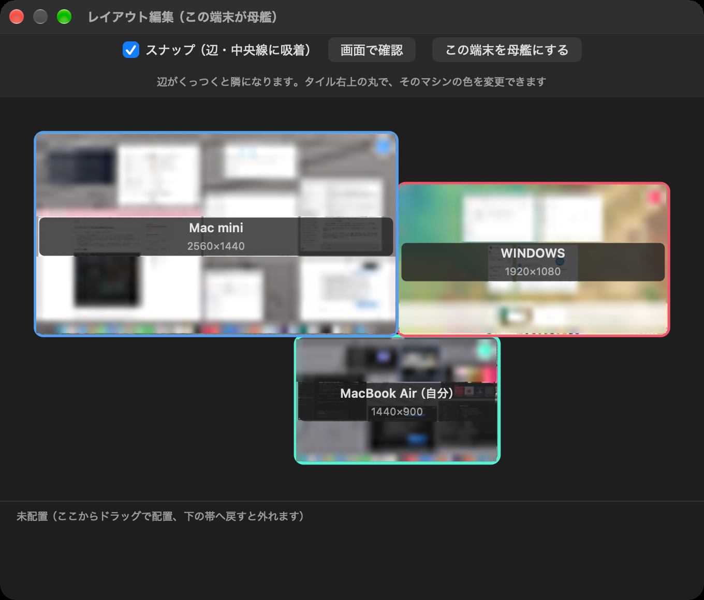

# OneManCursor (ワンマンカーソル)

[日本語](README.md) | English

A menu bar app for Mac that combines three tools into one.

- **Finder swipes**: When Finder is frontmost, navigate with trackpad swipes — back / forward / up to the parent folder / open.
- **Cursor sharing**: Push the cursor past a screen edge and control passes to the neighboring machine. Works between Macs, and between Mac and Windows too (with the companion app in `windows/` on the Windows side). Machines learn their neighbors automatically, so the only setup is the layout on the Mac side.
- **Always-visible cursor**: Draws a large cursor over the real one (handy when the real cursor disappears during remote control, such as in text fields). It hides itself automatically while the cursor is shared, so you never see two cursors.

It also syncs work across machines: Mission Control / Task View sync opens the window overview on every machine at once, and Search sync (beta) opens ⌘+Space search on all machines at the same time. See the [manual](en/Manual.md) for details.

## Layout editor




While the editor is open, each tile shows a thumbnail of that machine's screen, a few seconds behind. In the image above you can even see Mission Control open on the MacBook Air at the bottom right — all machines opened it together via the sync feature. Screen contents are blurred in these screenshots for posting.

Arrange machines on a canvas like the Displays settings pane. Just drag the tiles into place and the neighbor relationships are distributed to every machine automatically. Offset layouts (edges that only partly overlap), triangles and rings are all supported. Each machine gets its own color (the circle at the top right of a tile), and when the cursor approaches a screen edge, the frame glows in the color of the machine on that side.

*Note: merely opening the editor does not distribute anything. Move a tile (or change a color) and the current arrangement is sent to all machines. If you reinstall the app on one machine, nudge a tile once to redistribute.*

For a quick start, see [en/HowToUse.md](en/HowToUse.md), and for the full manual, [en/Manual.md](en/Manual.md).

## Download

Get the finished builds from [Releases](https://github.com/riryo3/OneManCursor/releases).

- **Mac**: Unzip `OneManCursor.zip` and put `OneManCursor.app` in your Applications folder. On first launch, right-click → Open, then grant the Accessibility and Input Monitoring permissions.
- **Windows** (as a cursor-sharing partner): Run `OneManCursor.exe` from `OneManCursor-Windows.zip`; it lives in the task tray.

## Building it yourself

On a Mac with Xcode:

```
sh build.sh
```

This produces `OneManCursor.app`.

For Windows, run `build.bat` in the `windows/` folder to build `OneManCursor.exe` (a task tray app).

## Notes

- **Only a Mac can be the origin (the driver).** The Windows version is a participant that receives and hands back control, so you can't start a session from a Windows machine or connect Windows machines only. With at least one Mac, the rest can be Windows.
- This is a personal prototype. The signals are not authenticated; it is designed for use on a home LAN.
- Trackpad finger data uses a private macOS framework (MultitouchSupport).
- Text being composed with an IME does not transfer to other machines.

## License

MIT
