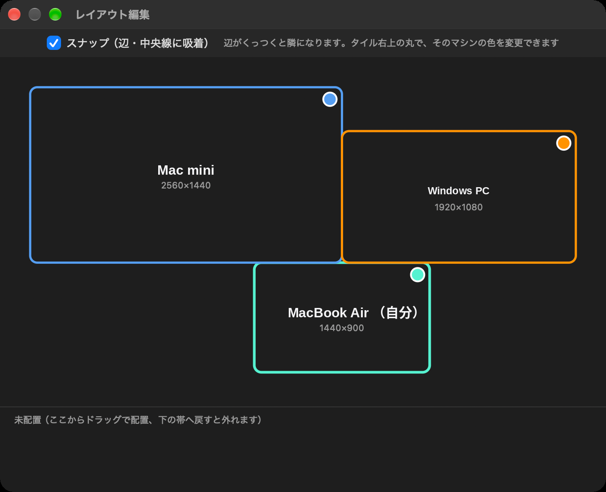

# ワンマンカーソル (OneManCursor)

Mac のメニューバー常駐アプリ。3つの道具を1つにまとめました。

- **Finder スワイプ**: Finder が最前面のとき、トラックパッドのスワイプで「戻る / 進む / 上の階層 / 開く」
- **カーソル共有**: 画面の端からカーソルを押し出すと、隣のマシンに操作が移ります。Mac 同士はもちろん、Windows とも行き来できます(Windows 側は `windows/` の常駐アプリ)。隣のマシンは自動で覚えるので、設定は Mac 側のレイアウトだけ
- **大きなカーソル表示**: カーソルの位置に大きなカーソルを重ねて描きます(リモート操作で本物のカーソルが見えなくなる場面の対策)。共有セッション中は自動で止まるので、二重に見えることはありません

## レイアウト編集



配置はディスプレイ設定のような画面で決めます。タイルをドラッグして並べるだけで、隣同士の関係が全マシンに自動で配られます。ずらした配置（辺の一部だけが重なる形）や、三角形・輪のつながりも作れます。タイル右上の丸でマシンごとに色を変えられ、カーソルを画面の端に近づけると、行き先のマシンの色で画面の輪郭が光ります。

詳しい使い方は [つかいかた.md](つかいかた.md) を見てください。

## 入手

[Releases](https://github.com/riryo3/OneManCursor/releases) から完成品をダウンロードできます。

- **Mac**: `OneManCursor.zip` を展開し、`OneManCursor.app` をアプリケーションフォルダへ。初回は右クリック →「開く」で起動し、アクセシビリティと入力監視の許可を付けてください
- **Windows**(カーソル共有の相手役): `OneManCursor-Windows.zip` の `OneManCursor.exe` を起動すると、タスクトレイに常駐します

## 自分でビルドする場合

Xcode の入った Mac で:

```
sh build.sh
```

`OneManCursor.app` ができます。

Windows 側は `windows/` フォルダで `build.bat` を実行すると `OneManCursor.exe` ができます(タスクトレイに常駐します)。

## 注意

- **カーソル共有の起点(運転手)になれるのは Mac だけです。** Windows 版は受け取って返す参加者専用なので、Windows 同士や、Windows から操作を始めることはできません。Mac が1台あれば、残りは Windows でも行き来できます
- 個人の試作です。合図の通信に認証はありません。家庭内 LAN での使用を想定しています
- トラックパッドの指データは macOS の非公開フレームワーク(MultitouchSupport)を使っています
- IME の変換中文字は他のマシンへ渡りません

## ライセンス

MIT
